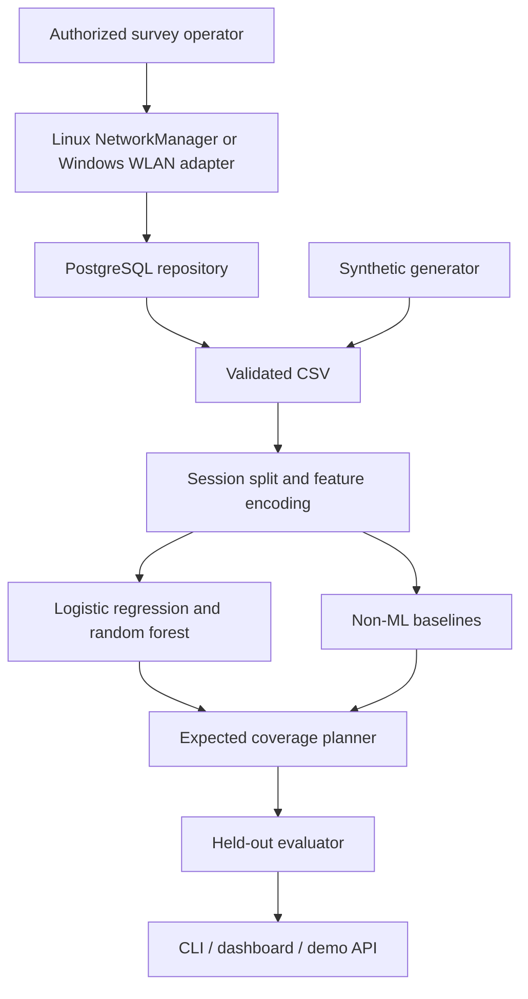

# SpectraSeek — baseline requirements and design

## Problem and scope
Network administrators and student researchers need to survey a known, authorized AP inventory efficiently. A fixed-budget manual survey wastes scans on locations with overlapping coverage. SpectraSeek recommends sites with high predicted marginal coverage. It does not locate people or devices outside an authorized inventory, infer physical AP positions, detect attacks, or optimize walking routes in this release.

## Requirements and traceability
| ID | Requirement / acceptance criterion | Design / implementation | Test |
|---|---|---|---|
| FR-01 | Collect approved AP visibility at a selected site; malformed or failed scan must not be accepted | NetworkManager or Windows WLAN collector, CLI scan | Linux scanner parser, Windows BSS parsing and scan timeout tests |
| FR-02 | Persist each scan atomically in PostgreSQL and reject duplicate or incompatible scans | SurveyRepository, composite keys, survey protocol fingerprint | postgres_schema, PostgreSQL integration tests |
| FR-03 | Validate complete datasets with explicit negatives, stable coordinates, and preserved identifiers | dataset.validate, dataset.load_csv | Dataset validation and CSV round-trip regression tests |
| FR-04 | Generate reproducible simulated survey data, marked synthetic | dataset.simulate | reproducible |
| FR-05 | Evaluate two ML models and an empirical baseline on chronological holdouts | experiment.evaluate | holdout, no_test_label_leakage, expanding window regression tests |
| FR-06 | Compare search plans under identical site budgets | planning.greedy/oracle, experiment.evaluate | greedy, holdout |
| FR-07 | Recommend a remaining site excluding found targets | experiment.recommend | next_site |
| FR-08 | Expose evaluation via CLI, local API and dashboard | cli, api, dashboard | CLI and API tests, Streamlit single-site and recommendation regression test |

Nonfunctional: validated inputs, explicit failures, stable seeds, session isolation, local-only default binding, no stored unrelated BSSIDs, no embedded credentials, Python-only source, modular design and documented limitations. Prototype usability: CLI and local dashboard; no production latency or scale claims.

Use case: operator registers authorized inventory and sites, collects full sessions, exports CSV, evaluates models and search baselines, then recommends a remaining site. Alternate flow: invalid/incomplete dataset or unavailable adapter → error, no fabricated results. Acceptance: tests pass and synthetic experiment reproducible; real-world validation is a separate milestone.

## Design


Data model: `scans(session, site, captured_at, x, y)` with composite PK `(session, site)`. `observations(session, site, target, detected, signal_quality)` has PK `(session, site, target)` and FK to scans; detection and signal constraints apply. The inventory lives in operator-controlled JSON. The singleton `survey_protocol` table stores a fingerprint of the normalized inventory, site coordinates, signal threshold, and collector. Its first write and the scan are atomic. Existing scans with no fingerprint remain exportable and cannot receive new scans. Raw BSSIDs stay in the operator's configuration.

Class/module responsibilities: immutable `ScanResult` carries timestamp and signal quality map; `SurveyRepository` owns transactions and exports; pure dataset/planning functions validate and optimize; experiment owns training and evaluation; CLI/API/UI are presentation layers. This keeps hardware and persistence separate from research algorithms.

## UI wireframe
```
SpectraSeek | survey CSV | site budget
Records | Sites | Targets | Held-out sessions
[Search performance] [ML evaluation] [Survey data]
Coverage comparison chart | model metrics | recommendations
Next site: [visited] [found] [strategy] [Recommend]
[Download evaluation] [Download survey CSV]
```

## Limits and academic compliance
The baseline contains synthetic data only. Collect authorized real surveys and retain evidence, report actual dataset records and measured results, document training/test split and hardware configuration, and prepare the final SRS/SDD and presentation. Python is the project language. The current scope is a local research prototype. Future work includes adaptive policy evaluation and deployment hardening.
